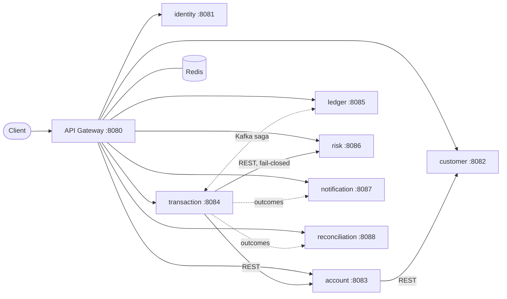

# FinCore: simulated digital banking platform (Java 21, Spring Boot, Kafka)

A portfolio-grade, production-*oriented* microservices project: internal money transfers backed by a **double-entry ledger**,
an idempotent **saga** over Kafka with a **transactional outbox**, risk/fraud rules, notifications, reconciliation,
JWT security, resilience and observability.

> **Simulation only.** No real money, customers, banks or regulators are involved. It makes no regulatory or
> compliance claim (PCI, PSD2, SOC 2, ...). All data is synthetic.

## 0. Verification status (read this first)

This project was generated in a sandbox with **Java 21 but no Maven Central access and no Docker**. What that means:

| Area | Status |
|---|---|
| Framework-free domain code (ledger math, journal balancing, balances/holds, state machine, risk rules, reconciliation, idempotency fingerprint, KYC, password/lockout policy, message templates) and the Kafka event codec | **Compiled with `javac -Werror` and tested: 97 JUnit 5 tests passed.** Reproduce with `scripts/verify-domain.sh`. |
| All 170 Java files | Passed a `javac` **syntax-only** pass (no parse errors). Symbol resolution against Spring/Kafka/JPA jars was **not** possible, so the Spring layers were **not compiled**. |
| `mvn verify` (Spring Boot services, Mockito tests, Testcontainers `*IT`s) | **Not executed.** Written to be run on a machine with Maven 3.9+, JDK 21 and Docker. Expect to fix small compile-level details on first build. |
| `docker compose up`, Kafka/Redis/Postgres runtime behaviour, demo scripts, Grafana/Prometheus | **Not executed.** Compose and YAML files were parsed for validity only. |

Nothing above is claimed as passing unless it appears in the first row.

## 1. Business use cases
Register and log in; create a customer profile with simulated KYC; open an account; receive simulated funds (admin deposit);
transfer money to another customer's account; see balances (ledger vs available) and paginated history; get notified;
admin reversal of a completed transfer; risk review queue; daily reconciliation against a synthetic settlement file; audit trail.

## 2. Architecture

Full diagram, trust model and package layout: [docs/architecture.md](docs/architecture.md).

| Service | Responsibility |
|---|---|
| api-gateway | JWT check, Redis rate limit, correlation id, header stripping, circuit breakers, problem+json errors |
| identity-service | users, BCrypt, lockout, JWT issuing (roles `CUSTOMER`, `ADMIN`) |
| customer-service | profile, simulated KYC workflow |
| account-service | account master data, status, limits; emits `account.opened` / `account.status.changed` |
| transaction-service | transfer state machine, idempotency, saga, recovery, reversal and review |
| **ledger-service** | **double-entry journals, balances (ledger/available), holds, reversal; DB-enforced invariants** |
| risk-service | deterministic rule engine (limits, velocity, repetition), auditable decisions |
| notification-service | idempotent event consumer, retry + DLT, simulated email |
| reconciliation-service | expected vs settlement matching, exception report, repeatable runs |
| platform-commons | **technical** shared code only: security, errors, outbox, idempotent consumer, DLT policy, audit, event records |

## 3. Technology
Java 21 · Spring Boot **3.3.5** · Spring Cloud **2023.0.3** (Gateway) · Spring MVC / WebFlux (gateway) · Spring Data JPA + Hibernate ·
Spring Security OAuth2 Resource Server (JWT) · PostgreSQL 16.4 · Apache Kafka 3.8 (KRaft) · Redis 7.4 · Flyway · Resilience4j 2.2.0 ·
springdoc OpenAPI 2.6.0 · Micrometer + Prometheus + Grafana 11.2 · OpenTelemetry (OTLP -> Jaeger 1.60) · JUnit 5, Mockito,
Testcontainers · Docker/Compose · GitHub Actions. Versions are pinned in the root `pom.xml` and `docker-compose.yml`. Lombok is not used.

## 4. Quick start
Prerequisites: Docker with Compose v2, `curl`, `jq`. (Maven and JDK 21 only if you build outside Docker.)
```bash
scripts/init-env.sh                       # generates .env with strong random secrets (never committed)
docker compose up -d --build              # infra + 8 services + gateway (first build takes several minutes)
docker compose ps                         # wait until everything is "healthy"
scripts/demo-transfer.sh                  # end-to-end scenario with output
```
Observability: `docker compose --profile observability up -d` -> Grafana http://localhost:3000 (admin / `GRAFANA_ADMIN_PASSWORD`),
Prometheus http://localhost:9090, Jaeger http://localhost:16686 (always on).

**Lightweight mode** (laptop with little RAM): start only the infrastructure and run the services you need from Maven:
```bash
docker compose up -d postgres kafka redis
set -a; . ./.env; set +a
export SPRING_DATASOURCE_PASSWORD="$LEDGER_DB_PASSWORD"          # per service: <SVC>_DB_PASSWORD
mvn -pl ledger-service -am spring-boot:run
```
Defaults in each `application.yml` point at `localhost`; override with the environment variables in section 8.

## 5. API examples (curl)
```bash
set -a; . ./.env; set +a; B=http://localhost:8080
# register + login
curl -s $B/api/v1/auth/register -H 'Content-Type: application/json' \
  -d '{"username":"alice","email":"alice@example.test","password":"Str0ng!Passw0rd-1"}'          # -> userId, customerId
TOKEN=$(curl -s $B/api/v1/auth/login -H 'Content-Type: application/json' \
  -d '{"username":"alice","password":"Str0ng!Passw0rd-1"}' | jq -r .accessToken)
# customer profile (simulated KYC: VERIFIED) and an account
curl -s $B/api/v1/customers -H "Authorization: Bearer $TOKEN" -H 'Content-Type: application/json' \
  -d '{"fullName":"Alice Rao","email":"alice@example.test","phone":"+919876543210","dateOfBirth":"1990-05-01","documentType":"PASSPORT","documentNumber":"ABCDE1234F"}'
ACC=$(curl -s $B/api/v1/accounts -H "Authorization: Bearer $TOKEN" -H 'Content-Type: application/json' -d '{"currency":"INR"}' | jq -r .accountId)
# admin credits funds, then check the balance
ADMIN=$(curl -s $B/api/v1/auth/login -H 'Content-Type: application/json' -d "{\"username\":\"admin\",\"password\":\"$BOOTSTRAP_ADMIN_PASSWORD\"}" | jq -r .accessToken)
curl -s $B/api/v1/ledger/deposits -H "Authorization: Bearer $ADMIN" -H 'Content-Type: application/json' \
  -d "{\"reference\":\"$(uuidgen)\",\"accountId\":\"$ACC\",\"amount\":5000.00,\"currency\":\"INR\"}"
curl -s $B/api/v1/accounts/$ACC/balance -H "Authorization: Bearer $TOKEN"
# transfer (Idempotency-Key is mandatory) - repeat the exact same call to see the idempotent replay (HTTP 200)
curl -si $B/api/v1/transfers -H "Authorization: Bearer $TOKEN" -H 'Idempotency-Key: rent-2026-10-0001' -H 'Content-Type: application/json' \
  -d "{\"sourceAccountId\":\"$ACC\",\"destinationAccountId\":\"<other-account-id>\",\"amount\":1000.00,\"currency\":\"INR\",\"description\":\"rent\"}"
```
Every endpoint (request/response, status codes, validation, authorization, errors): [docs/api-catalog.md](docs/api-catalog.md).

## 6. Sample transfer workflow
1. `POST /transfers` -> ownership, currency, limits checked; risk assessed (fail-closed); one transaction stores `INITIATED` + outbox event; **202**.
2. Outbox relay publishes `transfer.initiated` -> ledger **reserves** funds under a row lock (available balance drops, ledger balance unchanged).
3. `ledger.funds.reserved` -> transfer `PENDING` -> `ledger.posting.requested` -> ledger **posts** a balanced journal.
4. `ledger.posting.completed` -> transfer `COMPLETED` -> `transfer.completed` -> notifications and reconciliation expectation.

Sequence diagram, state machine, compensations, recovery: [docs/transfer-workflow.md](docs/transfer-workflow.md).

## 7. Financial correctness guarantees (and where they are enforced)
Balanced journals (deferred DB trigger), immutable history (DB triggers), no negative/over-held balances (CHECK constraints + domain types),
serialised concurrent spenders (ordered row locks), one financial effect per transfer (idempotency keys + UNIQUE constraints + consumer dedupe),
no lost events (transactional outbox), reversals as compensating journals, exact decimal money (`NUMERIC(19,4)`/`BigDecimal`, excess precision rejected).
Table with tests: [docs/financial-invariants.md](docs/financial-invariants.md). Consistency model: eventual between services (saga), ACID inside each.

## 8. Kafka event flow
```
account.opened ------------------------------------------> ledger
transfer.initiated -> ledger.funds.reserved|rejected -----> transaction
ledger.posting.requested -> ledger.posting.completed|failed -> transaction
transfer.completed|failed|reversed --------------------------> notification, reconciliation
transfer.reversal.requested -> ledger.reversal.completed|failed -> transaction
settlement.received -----------------------------------------> reconciliation        (every topic has <topic>.DLT)
```
Keys, ordering limits, outbox, retries/DLT, "exactly-once" caveats: [docs/kafka-design.md](docs/kafka-design.md).

### Environment variables
| Variable | Used by | Meaning |
|---|---|---|
| `JWT_SECRET` | all | HS256 secret, >= 32 bytes; startup fails if missing/placeholder |
| `BOOTSTRAP_ADMIN_PASSWORD` | identity | password of the initial `admin` user (must satisfy the password policy) |
| `SPRING_DATASOURCE_URL` / `_USERNAME` / `_PASSWORD` | each service | its own database and role (`<svc>_db` / `<svc>_user`) |
| `<SVC>_DB_PASSWORD`, `POSTGRES_PASSWORD` | compose | per-service role passwords created by `init-databases.sh` |
| `KAFKA_BOOTSTRAP_SERVERS` | kafka services | default `localhost:9092` (compose: `kafka:9092`; host access `localhost:29092`) |
| `REDIS_HOST`, `REDIS_PORT`, `REDIS_PASSWORD` | gateway | rate limiter store |
| `ACCOUNT_SERVICE_URL`, `RISK_SERVICE_URL`, `CUSTOMER_SERVICE_URL` | transaction, account | downstream base URLs |
| `CORS_ALLOWED_ORIGINS` | gateway, services | comma-separated origins; empty = none |
| `NOTIFICATION_FAILURE_SIMULATION` | notification | enables the DLT demo hook (keep `false` outside demos) |
| `OTEL_EXPORTER_OTLP_TRACES_ENDPOINT`, `TRACING_SAMPLING` | all | tracing export |
| `RATE_LIMIT_API_RPS/BURST`, `RATE_LIMIT_AUTH_RPS/BURST` | gateway | token-bucket sizes |

## 9. Database migrations
Flyway runs automatically at service start (`classpath:db/migration` per service + `classpath:db/platform` for outbox/processed-events/audit tables).
Hibernate is `ddl-auto=validate`. Inspect: `docker compose exec postgres psql -U ledger_user -d ledger_db -c '\dt'`.
Design and indexes: [docs/database-design.md](docs/database-design.md).

## 10. Tests
```bash
scripts/verify-domain.sh        # JDK + JUnit only: 97 framework-free tests (this is what was verified)
mvn test                        # unit tests (*Test, incl. Mockito saga test, gateway filter test) - no Docker
mvn verify                      # + integration tests (*IT) with Testcontainers: needs Docker
mvn -pl ledger-service verify   # one module
```
Integration/concurrency tests: `LedgerIT` (12 threads vs 5 slots, duplicate commands, DB triggers, CHECKs, reversal), `TransferIdempotencyIT`
(10 concurrent identical requests -> 1 transfer; key misuse; risk fail-closed), `OutboxRelayIT` (rollback, broker outage, crash/redelivery),
`NotificationKafkaIT` (duplicate event, retry -> DLT, poison message), `CustomerAccessControlIT` (Spring Security, validation, problem+json, ownership).
Not implemented: a Redis-backed rate-limit integration test (the limiter is configured and documented but untested).

## 11. Failure demonstrations
`scripts/demo-outbox-crash.sh` (broker down), `scripts/demo-dlt.sh` (retry then dead-letter), `scripts/demo-transfer.sh` (retry, concurrency, reversal, reconciliation).
Scenario matrix and the fail-open/fail-closed policy per operation: [docs/failure-scenarios.md](docs/failure-scenarios.md).

## 12. Docker commands
```bash
docker compose up -d --build [--profile observability]     docker compose logs -f ledger-service
docker compose stop kafka && docker compose start kafka    docker compose down            # keep data
docker compose down -v                                     # also wipe volumes (fresh databases)
docker build --build-arg MODULE=ledger-service -t fincore/ledger .
```

## 13. Troubleshooting
* *`JWT_SECRET ... must be set`*: run `scripts/init-env.sh`; the value must not start with `change-me`.
* *Services unhealthy for ~1 min*: Flyway + Kafka admin start-up; `start_period` is 40 s. Check `docker compose logs <svc>`.
* *`password authentication failed`*: the Postgres volume was initialised with old passwords; `docker compose down -v` and start again.
* *Balance endpoint 404 right after opening an account*: the ledger projection arrives through Kafka a moment later; retry.
* *Transfer stays `INITIATED`*: the ledger or Kafka is down; the recovery job re-drives after 120 s. Check `fincore_outbox_pending` and DLT topics.
* *Port clashes*: services bind to 127.0.0.1:8081-8088, 5432, 29092, 3000, 9090, 16686; edit `docker-compose.yml`.

## 14. Known limitations
Single-node Kafka/Postgres, replication factor 1; no schema registry (JSON with `schemaVersion`); outbox head-of-line blocking on a poison row;
DLT messages are re-driven manually; idempotency keys never expire; one currency per transfer (no FX); daily limit is a rolling 24 h window;
recovery job has no leader election (safe because commands are idempotent; `SKIP LOCKED` prevents double pick-up); synthetic KYC; no pagination
on the account list; Swagger UI is enabled by default (`fincore.security.expose-api-docs`).

## 15. Security limitations
HS256 shared secret (any service can mint tokens; use RS256/ES256 + JWKS), no token revocation/refresh, no TLS or mTLS in the compose setup,
rate limiter fails open if Redis is down and keys on the remote address (needs a trusted proxy header in production), Prometheus/health endpoints are
unauthenticated inside the network, service ports are published to localhost for development, no WAF, no secrets manager, passwords for the
synthetic admin come from an env var. Not suitable for real financial data.

## 16. Future improvements
Asymmetric JWT/JWKS, mTLS, schema registry (Avro/Protobuf), DLT re-drive UI, outbox parking, idempotency-key TTL, FX and fees (explicit rounding),
statements and period close, Debezium CDC for the outbox, contract tests, chaos/failure-injection tests in CI, Kubernetes manifests, distributed
lock for singleton jobs, richer risk (device, geo, ML scoring).

## 17. Repository layout
```
pom.xml  docker-compose.yml  Dockerfile  .env.example  .gitignore
platform-commons/  api-gateway/  identity-service/  customer-service/  account-service/
transaction-service/  ledger-service/  risk-service/  notification-service/  reconciliation-service/
docs/ (architecture, ADRs, workflow, invariants, API catalog, Kafka, database, failures, interview guide)
infrastructure/ (postgres init, prometheus, grafana)   scripts/ (env, verify, demos, packaging)   .github/workflows/ci.yml
```
Maven wrapper is not included (it needs network access to generate); install Maven 3.9+ or run `mvn wrapper:wrapper`.
