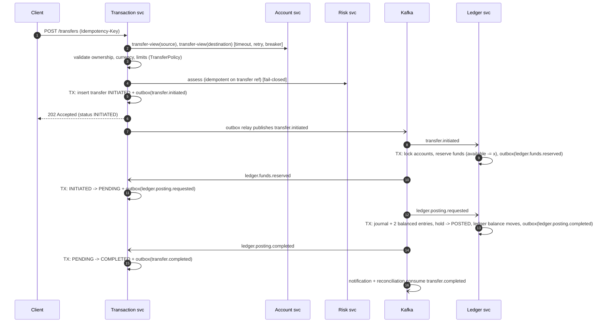

# Internal transfer workflow and consistency model

## Consistency model

* **Inside a service**: ACID. Every state change, the outbox event it causes and the dedupe marker commit in one
  PostgreSQL transaction.
* **Across services**: **eventual consistency through a choreographed saga**. There is no distributed transaction and no
  two-phase commit. A transfer is visibly `INITIATED` / `PENDING` while the saga runs, and the API says so (HTTP 202).
* **Money is never created or lost**: the ledger is the only writer of balances; its operations are idempotent on the
  transfer reference; failures are compensated by releasing the hold (local to the ledger) or by a compensating journal.

## Happy path

**Why two ledger phases (reserve, then post)?** The reservation is the concurrency-safe guarantee: funds are claimed
under a row lock before anything else happens, and the *ledger balance* and *available balance* are genuinely different
numbers while a transfer is in flight (`available = ledger - holds`). Posting then converts the hold into an immutable
journal. The transaction service can also pause between the phases (the risk `REVIEW` path pauses *before* reserving).

## State machine

`PENDING_REVIEW -> INITIATED | FAILED`, `INITIATED -> PENDING | FAILED`, `PENDING -> COMPLETED | FAILED`,
`COMPLETED -> REVERSING`, `REVERSING -> REVERSED | COMPLETED`. `FAILED` and `REVERSED` are terminal. The entity has one
choke point (`transitionTo`) that enforces this; every saga handler is state-guarded, so duplicate, late or re-driven
events are ignored instead of corrupting a transfer. Each transition is also written to `transfer_state_history`.

## Compensations

| Failure | Compensation |
|---|---|
| Insufficient funds / frozen source / closed destination at reserve | `ledger.funds.rejected` -> `FAILED`, nothing was debited |
| Destination closed between reserve and post | the ledger **releases the hold** in the same transaction and emits `ledger.posting.failed` -> `FAILED` |
| Risk REJECT | transfer recorded as `FAILED(RISK_REJECTED)`, no ledger command is ever sent |
| Risk REVIEW | `PENDING_REVIEW`; an admin approves (-> `INITIATED`) or rejects (-> `FAILED`) |
| Completed transfer must be undone (admin) | `REVERSING` -> ledger posts a **compensating journal** (flipped lines, linked to the original) -> `REVERSED` |
| Reversal impossible (receiver spent the money) | `ledger.reversal.failed` -> back to `COMPLETED` with `reversalFailureReason` |

## Recovery

`StuckTransferRecovery` re-drives transfers stuck in `INITIATED` / `PENDING` / `REVERSING` longer than
`fincore.recovery.stale-after-seconds`: it re-publishes the *pending command* (same transfer reference, new event id).
It does **not** fail the transfer on a timeout. That would risk "failed" while the ledger actually moved the money.
Ledger commands are idempotent on the reference, so a re-drive either does the work or re-emits the stored outcome.
After `max-attempts` the transfer is flagged `needs_attention` (gauge `fincore_transfers_needs_attention`) for a human.

## Idempotency

1. The transfer id is `UUIDv3(customerId : Idempotency-Key)`. A retry always maps to the same id.
2. Existing row for the key: same payload fingerprint -> **200** with the stored transfer and `Idempotent-Replay: true`;
   different payload -> **422 `idempotency-key-reuse`**.
3. Concurrent identical requests race on `UNIQUE (customer_id, idempotency_key)`; the loser catches the violation,
   reloads the winner's row and replays it.
4. The risk call is idempotent on the same reference, and the ledger deduplicates on `transfer_ref` (UNIQUE on holds
   and on `(reference, journal_type)` of journals), so a replay cannot create a second financial effect at any layer.
